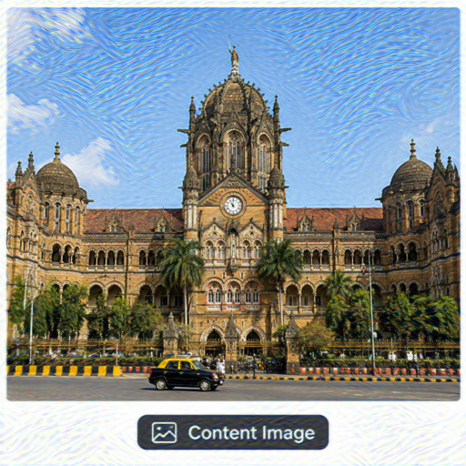
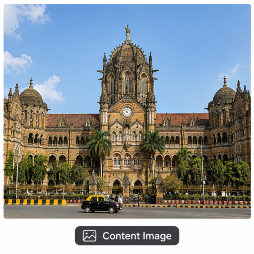
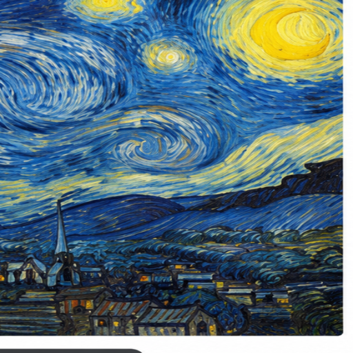

# Neural Style Transfer using VGG19 and PyTorch 🎨

A Deep Learning project that applies the artistic style of one image to another while preserving the original image's content and structure.

Developed as part of the **Prodigy InfoTech Generative AI Internship – Task 5**.

## Project Overview

Neural Style Transfer combines two images:

- **Content Image:** Provides the original structure and objects.
- **Style Image:** Provides artistic patterns, textures and colours.
- **Generated Image:** Combines the content of the first image with the artistic style of the second.

This project uses a pretrained VGG19 network to extract image features and optimize a generated image using content loss and style loss.

## Example

The project uses:

- Content: Mumbai CST-style building photograph.
- Style: Van Gogh-inspired Starry Night painting.
- Output: A building photograph with artistic textures inspired by the style image.

## Technologies Used

- Python
- PyTorch
- Torchvision
- VGG19
- NumPy
- Matplotlib
- Pillow
- Google Colab
- CUDA GPU

## Model Architecture

### VGG19 Feature Extraction

A pretrained VGG19 model with ImageNet weights is used as a feature extractor.

Selected style layers:

| Layer | Feature Channels |
|---|---:|
| conv1_1 | 64 |
| conv2_1 | 128 |
| conv3_1 | 256 |
| conv4_1 | 512 |
| conv5_1 | 512 |

Content representation:

- conv4_2

The VGG19 parameters are frozen during optimization.

### Gram Matrix

Gram Matrices capture correlations between feature channels and represent the artistic style of an image.

The Gram Matrix is calculated for each selected style layer.

### Loss Functions

The optimization combines content loss and style loss.

**Total Loss:**

`L_total = α × L_content + β × L_style`

Where:

- Content loss preserves the original image structure.
- Style loss encourages the generated image to match the reference painting.
- α is the content weight.
- β is the style weight.

## Implementation Details

| Parameter | Value |
|---|---|
| Feature extractor | Pretrained VGG19 |
| Input image size | 512 × 512 |
| Optimizer | Adam |
| Learning rate | 0.003 |
| Optimization steps | 500 per experiment |
| Content weight | 1 |
| Experiment 1 style weight | 1,000,000 |
| Experiment 2 style weight | 5,000,000 |
| Hardware | Google Colab CUDA GPU |

## Experimental Results

Two experiments were performed with different style weights.

| Metric | Experiment 1 | Experiment 2 |
|---|---:|---:|
| Style weight | 1,000,000 | 5,000,000 |
| Content loss | 7.8226 | 11.0645 |
| Style loss | 0.000020 | 0.000018 |
| Total loss | 27.6558 | 102.8649 |

### Visual Results

**Experiment 1 – Style Weight 1M**



**Experiment 2 – Style Weight 5M**


**Original Content Image**



**Style Reference Image**



### Observations

- Both experiments successfully optimized the generated image.
- Increasing the style weight changed the balance between content preservation and style matching.
- Experiment 1 provided the preferred balance in the visual comparison.
- The artistic effect was more visible in the sky and surrounding textures than on the building itself.

The loss values are optimization measurements, not direct measures of perceptual quality.

## Project Structure

```text
Neural-Style-Transfer/
│
├── Neural_Style_Transfer.ipynb
│
├── images/
│   ├── content_image.png
│   └── style_image.png
│
├── results/
│   ├── style_weight_1M.png
│   ├── style_weight_5M.png
│   ├── evaluation_results.json
│   └── loss_history.json
│
├── README.md
└── requirements.txt
```

## How to Run

### 1. Open the Notebook

Open `Neural_Style_Transfer.ipynb` using Google Colab.

### 2. Enable GPU

Select:

Runtime → Change runtime type → T4 GPU (if available).

### 3. Install Dependencies

```bash
pip install torch torchvision numpy matplotlib pillow
```

### 4. Upload Images

Upload:
- Content image
- Style image

### 5. Execute Notebook

Run the notebook cells sequentially to:

1. Preprocess input images.
2. Load pretrained VGG19.
3. Extract content and style features.
4. Calculate Gram Matrices.
5. Define content and style losses.
6. Optimize the generated image.
7. Compare and save the results.

## Limitations

- The generated result does not fully reproduce the painting's artistic appearance.
- Style transfer can be subtle depending on the selected layers and weights.
- The optimization process is performed on image pixels rather than training a new neural network.
- Results depend on image selection, optimization settings and feature-layer selection.

## Future Improvements

- Experiment with different artistic styles.
- Optimize content and style weights.
- Test different VGG19 feature-layer combinations.
- Experiment with larger image resolutions.
- Develop an interactive Streamlit application.
- Explore faster neural style transfer methods.

## Author

**Tanishq Bhorpe**

B.Tech – Artificial Intelligence and Machine Learning

GitHub: https://github.com/tanishqbhorpe

LinkedIn: https://www.linkedin.com/in/tanishq-bhorpe

---

*Developed as part of the Prodigy InfoTech Generative AI Internship – Task 5.*
